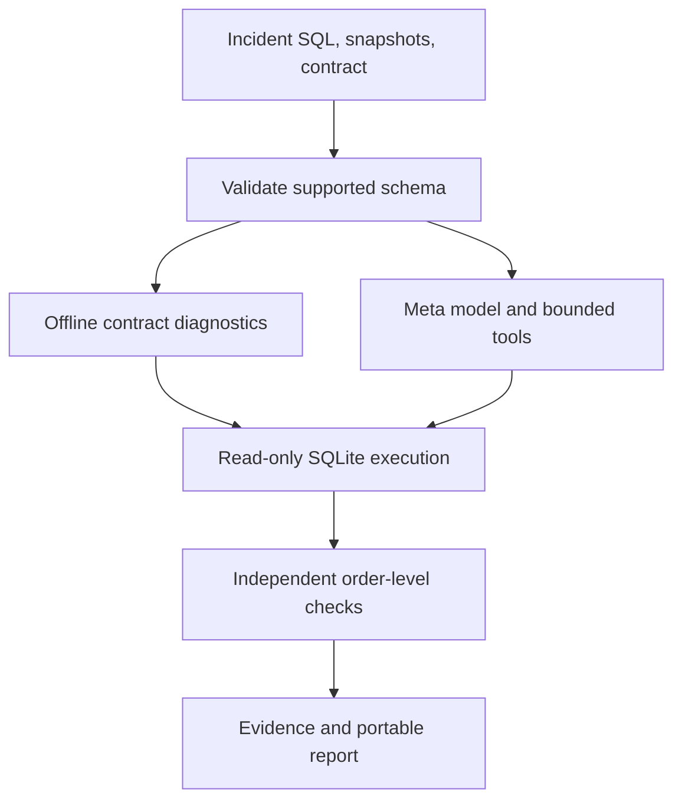

# DataTrace

**Explain why a business metric changed—and test the explanation.**

DataTrace investigates SQL metric movements through executed evidence and independent repair checks. It distinguishes calculation defects, genuine data changes, mixed changes, and incidents that need more evidence.

Built for the **Meta Global AI Developer Hackathon 2026**, Indie Developer track, **Build for Your World** theme.

## Application status

The local application includes five demo families, custom incident JSON and CSV snapshots, editable SQL and metric contracts, four-way SQL/snapshot replay, bounded queries, independent per-order repair checks, JSON/Markdown reports, run history, a Meta Responses tool loop, and a no-tools model baseline. Evaluation includes 20 development and 20 stress cases.

Offline mode runs deterministic diagnostics; **it is not AI inference or an AI accuracy benchmark**. Meta transport and agent behavior have automated mock tests, but authenticated inference remains unverified because no key is configured. The GitHub connector still returns 404 for the supplied repository; the local origin is configured and commits are preserved.

The current SQL runner is **SQLite**, available in Python's standard library. DuckDB package downloads were blocked in the development environment, so DuckDB migration remains planned. No production performance is claimed.

## Run locally

Requires Python 3.11+ and package-index access for a fresh install.

```powershell
python -m venv .venv
.\.venv\Scripts\python.exe -m pip install -e ".[dev]"
.\.venv\Scripts\python.exe -m streamlit run app.py
```

On macOS/Linux use `.venv/bin/python` instead. Choose **Offline evidence walkthrough** and click **Investigate metric change**; no API key is needed for this mode.

```powershell
.\.venv\Scripts\python.exe -m pytest -q
.\.venv\Scripts\python.exe -m datatrace.evaluate --mode offline
```

Run the additional stress set:

```powershell
.\.venv\Scripts\python.exe -m datatrace.evaluate --mode offline --split stress --output artifacts/stress.json
```

For paid model evaluation after setup, first run a single-case comparison, then expand it:

```powershell
.\.venv\Scripts\python.exe -m datatrace.evaluate --mode compare --allow-paid --limit 1 --output artifacts/meta-comparison.json
```

Use `--mode meta` for the tool-assisted system, `--mode baseline` for the same model without tools, and `--split stress` for new distributions/boundary cases. Optional `--input-rate` and `--output-rate` accept your current USD-per-million-token prices; otherwise costs remain unknown. All per-case reports, failures, repair checks, token counts, elapsed times, and provenance are retained. Failed requests may incur usage that is unavailable in their error responses; such runs are flagged incomplete. No live AI benchmark results are included.

## Load your own incident

Select **Incident JSON** or **Four CSV snapshots**. Download the example ZIP in the sidebar for a complete template. JSON format version 1 contains description, contract, previous/current SQL, and previous/current snapshots. It never contains evaluation labels.

| CSV | Required header |
| --- | --- |
| orders (previous and current) | `order_id,customer_id,order_date,status,kind,revenue_cents` |
| customers (previous and current) | `customer_id,region` |

Each file is limited to 1 MiB and each table to 2,000 rows. Order IDs must be unique positive integers. Revenue uses integer USD cents, dates use YYYY-MM-DD, status is paid/pending/cancelled, and kind is sale/refund. Duplicate customer keys are allowed so the investigator can detect multiplying joins. Metric SQL must return exactly `order_id, revenue_cents` rows, rather than a pre-aggregated scalar.

The supported contract includes an inclusive start, exclusive end, one eligible status, and include/exclude/unknown refund treatment. It includes unmatched customers and uses one row per order. Unsupported grains/units are rejected instead of silently misverified. Meta context has an additional size cap; reduce large incidents for live mode. Do not upload data you lack permission to use.

After an investigation, inspect the replay decomposition, executed evidence and correction checks. The **Verify a correction** tab checks your own SQL locally. The export tab downloads JSON execution evidence and a readable Markdown report. The last five reports remain in the browser session only; download them for persistence.

## Command-line workflow

```powershell
.\.venv\Scripts\python.exe -m datatrace sample --output incident.json
.\.venv\Scripts\python.exe -m datatrace investigate incident.json --output-dir artifacts/my-run
.\.venv\Scripts\python.exe -m datatrace verify incident.json correction.sql
```

Investigation defaults to offline diagnostics. Add `--mode meta --allow-paid` for live inference. Reports include input/source hashes, runtime versions, elapsed time, and the supplied contract. Commands return a nonzero exit status for invalid inputs, failed verification, or provider errors.

## Architecture



The baseline receives the same raw incident data and SQL, but no tool definitions or executed replay. Its proposed repairs are scored only after the model answers. Both modes apply the same missing-definition guard. Reports retain raw model classifications/repair attempts separately from the application's checked result.

## Investigation workflow

1. Supply previous/current SQL, previous/current data snapshots, and the metric definition.
2. A Meta model proposes hypotheses and selects diagnostic tools.
3. The in-memory SQLite runner executes bounded, read-only investigations against synthetic data.
4. Each conclusion cites executed queries and observed results.
5. A proposed SQL correction is checked in an isolated environment against metric invariants and regression checks.
6. Valid business changes are preserved; ambiguous definitions trigger a clarification request.

## Scope

- **Current stack:** Python, SQLite, Streamlit, Meta Model API. DuckDB remains planned.
- **Initial incidents:** duplicate joins, dropped records, incorrect date filters.
- **Demo cases:** broken calculation, real business growth, insufficient evidence.
- **Evaluation tooling:** 20 development and 20 stress incidents; same-model/no-tools baseline implemented. Actual live inference runs remain pending.
- **No production database connections or automatic production changes in the prototype.**

## Meta API setup

The project owner has confirmed that a Meta Model API account exists. Credit application, billing readiness, API-key availability, and a successful project API call remain unverified.

Copy `.env.example` to a local `.env` and fill it privately. `.env` is ignored by Git. Never put a real API key in source code, issues, screenshots, or demo recordings. Restart the app, select Live Meta investigator, confirm permission to send that incident to Meta, and explicitly run it. This sends raw incident inputs and executed evidence to Meta and uses billable inference. The tool-assisted flow stores provider response context for continuation via `previous_response_id`; the baseline does not request storage. Use only data permitted under your provider/account terms.

The default endpoint is `https://api.meta.ai/v1`, key environment variable `MODEL_API_KEY`, and model `muse-spark-1.3`. The transport uses the [official Responses tool-calling pattern](https://dev.meta.ai/docs/tool-calling), matched call IDs, and previous-response context. It restricts credentials to the official endpoint and blocks redirects. Two local tools are available: `query_snapshot` and `verify_correction`. Model-selected tools are capped at 12 calls, queries at two seconds/200,000 VM steps, and investigations at 150,000 reported tokens. Token ceilings are checked after responses and do not guarantee a monetary hard cap. There are no automatic provider retries.

Each final diagnosis must reference executed evidence. Repairs are checked independently against complete per-order values rather than only the old metric total. SQLite authorization denies writes, attachments, metadata reads, recursive CTEs, and functions outside an allowlist. This is a local synthetic-data prototype, not an OS sandbox or a production database service. Evidence references alone do not prove every sentence in a model explanation is correct.

## Project documents

- [Verified hackathon brief](docs/HACKATHON_BRIEF.md)
- [Project specification](docs/PROJECT_SPEC.md)
- [Evaluation plan](docs/EVALUATION_PLAN.md)
- [Submission checklist](docs/SUBMISSION_CHECKLIST.md)
- [Build plan and current status](docs/BUILD_PLAN.md)
- [Official resource links](docs/RESOURCES.md)
- [Completion plan](docs/IMPLEMENTATION_PLAN.md)
- [Validation evidence](docs/VALIDATION.md)
- [Demo walkthrough](docs/DEMO.md)
- [Submission draft](docs/SUBMISSION_DRAFT.md)

Local validation: **78 tests passed**, with **20/20 development and 20/20 stress
cases passing deterministic checks**. These are software/fixture results,
not Meta model accuracy. See VALIDATION.md for the environment and limits.

## Container option

```sh
docker build -t datatrace .
docker run --rm -p 127.0.0.1:8501:8501 --env-file .env datatrace
```

Container instructions are supplied but not validated in this environment. The application has no multi-user authentication and should remain local or behind your own access controls; it is not a ready-to-expose production service.

## Competition requirements

Public repository, meaningful Meta model use, event-built contributions, accessible three-minute demo video, and one submission per project. Submit by **November 4, 2026, 6:00 PM Pacific / 9:00 PM Eastern**. Verify the latest organizer updates before submitting.

Source: [Participant guide](https://cerebralvalley.ai/e/meta-ai-developer-hackathon/details), reviewed October 28, 2026 Pacific.

## Ownership and dependencies

Follow the licenses of all third-party dependencies and datasets. A project distribution license has not yet been selected. Public repository visibility alone does not grant an open-source license. Use synthetic data for the submitted prototype.
