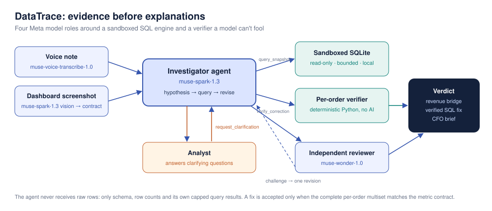

# DataTrace

**An agent that tells you whether a metric jump is real or the dashboard is wrong, and proves it.**

It's 8 a.m., the CFO review is at 10, and *Paid November revenue* jumped 68% overnight. Black Friday was strong, but is all of it real?
DataTrace's Meta-powered agent investigates the change with executed SQL evidence. It separates genuine business movement from reporting errors down to the individual order, and reports a fix only after an independent checker verifies it.

> **Flagship result** (real recorded run, 4,122 orders): revenue moved **+$129,045**. **$115,080** is genuine holiday growth. **$13,966** is a reporting error: a CRM migration duplicated 126 customers (+$25,521 double-counted) while the new inner join dropped 131 orders (−$11,555). Verified fix: **$304,397**. Reviewed and supported by a second Meta model.

Built for the **Meta Global AI Developer Hackathon 2026**, Indie Developer track, **Build for Your World** theme.



## Why it matters

Analysts spend hours answering "is this number right?" before every leadership review. Generic AI chat can't answer it: it either guesses, or it needs every raw row pasted into its context, which leaks data and stops working at warehouse scale. DataTrace gives a Meta model the job an analyst actually does: form hypotheses, run targeted queries, test a fix against the metric's definition, and ask when the definition is missing.

## Meta models: four roles

| Model | Role |
| --- | --- |
| **`muse-spark-1.3`** | **Investigator agent.** A client-side tool loop: it plans hypotheses, writes diagnostic SQL, issues tool calls in parallel, revises from results, calls `request_clarification` when the contract is incomplete, and proposes a correction it must test with `verify_correction`. Reasoning summaries stream into the UI. |
| **`muse-wonder-1.0`** | **Independent reviewer.** Sees only the executed evidence, contract checks and the diagnosis, never the agent's reasoning. Returns a structured verdict (JSON schema). A challenge sends the agent back for one evidence-backed revision. Also drafts the two-sentence stakeholder brief. |
| `muse-spark-1.3` (vision) | **Intake.** Reads a dashboard screenshot and message and drafts the metric contract for the analyst to confirm. |
| **`muse-voice-transcribe-1.0`** | **Voice intake.** Turns a stakeholder's voice note into the incident description (`/v1/asr/transcribe`). |

## Benchmark: the agent vs. the same model without tools

**320 paid runs.** Every case was run 3× (warehouse-scale 2×). The baseline is the same `muse-spark-1.3`, with all raw rows in its prompt and no tools. **Agent: 159/160 correct. Baseline: 150/160.** Full table, including latency: [results/BENCHMARK.md](results/BENCHMARK.md).

<!-- BENCHMARK_START -->
| Split | System | Correct diagnosis | Verified repair when needed | Errors / could not run | Input tokens per case | Est. cost per case |
| --- | --- | --- | --- | --- | --- | --- |
| Development (20 mini cases) | DataTrace agent (tools + verifier + reviewer) | 59/60 | 36/36 | 1/60 | 9,710 | $0.039 |
| Development (20 mini cases) | Same model, no tools, raw rows in prompt | 60/60 | 36/36 | 0/60 | 996 | $0.008 |
| Stress (20 mini cases, new values) | DataTrace agent (tools + verifier + reviewer) | 60/60 | 36/36 | 0/60 | 10,211 | $0.042 |
| Stress (20 mini cases, new values) | Same model, no tools, raw rows in prompt | 60/60 | 36/36 | 0/60 | 1,189 | $0.009 |
| Realistic (10 cases, ~4k orders) | DataTrace agent (tools + verifier + reviewer) | 30/30 | 18/18 | 0/30 | 14,180 | $0.061 |
| Realistic (10 cases, ~4k orders) | Same model, no tools, raw rows in prompt | 30/30 | 18/18 | 0/30 | 197,902 | $0.264 |
| Warehouse scale (5 cases, ~42k orders) | DataTrace agent (tools + verifier + reviewer) | 10/10 | 6/6 | 0/10 | 14,366 | $0.061 |
| Warehouse scale (5 cases, ~42k orders) | Same model, no tools, raw rows in prompt | 0/10 | 0/6 | 10/10 | 0 | $0.000 |
<!-- BENCHMARK_END -->

The honest reading:

- **On small data, both get the right answer.** A strong model can compute the answer from a few pasted rows, and there the baseline is cheaper and faster. The agent's one miss was a transient network error, since fixed with retries.
- **On realistic data (~4k orders), both are correct, but the agent uses 14× fewer input tokens and costs 4.3× less** ($0.061 vs. $0.264 per case), and it never sends a raw row to the model. It is slower (median 52s vs. 31s) because it runs real queries and a second-model review.
- **At warehouse scale (~42k orders), the baseline cannot run at all.** The rows are 2,064,623 tokens against a 1,048,576-token context window (`context_length_exceeded`). The agent still solves 10/10, because it only reads what it queries.
- 0 unneeded repairs and 100% verified repairs for the agent. A model cannot self-certify a fix: the per-order checker decides.

These are synthetic, author-generated incidents with hidden labels, not a production benchmark.

## What happens in an investigation

1. **Intake.** Voice note, screenshot or message. Meta models draft the metric contract; the analyst confirms it.
2. **Replay.** Previous and current SQL each run on previous and current snapshots (four executions), so code effects and data effects separate.
3. **Agent loop.** `muse-spark-1.3` tests hypotheses (fan-out from duplicate keys, inner-join drops, date and status boundaries, refund treatment) with bounded read-only queries. Every query carries a stated purpose, shown live.
4. **Clarify, don't guess.** If refund treatment is undefined, the agent pauses and asks; the same investigation resumes after the answer.
5. **Verify.** A proposed fix passes only if the **complete per-order multiset** matches the contract, not merely the total.
6. **Review.** `muse-wonder-1.0` challenges unsupported claims; the agent revises once if challenged.
7. **Act.** Verdict, revenue bridge, affected orders, verified SQL, CFO brief, and portable JSON/Markdown evidence.

## Run it

Python 3.11+.

```powershell
python -m venv .venv
.\.venv\Scripts\python.exe -m pip install -e ".[dev]"
copy .env.example .env      # then add MODEL_API_KEY privately
.\.venv\Scripts\python.exe run.py
```

macOS/Linux: `.venv/bin/python`. Without a key, the app opens in **Recorded live run** mode, which replays real Meta agent runs captured from this app at no cost. **Offline checks** runs deterministic diagnostics with no AI.

Command line:

```powershell
.\.venv\Scripts\python.exe -m datatrace sample --realistic crm_migration --output incident.json
.\.venv\Scripts\python.exe -m datatrace investigate incident.json --mode meta --allow-paid --review
.\.venv\Scripts\python.exe -m datatrace verify incident.json correction.sql
```

Reproduce the benchmark (billable; the full 320-run benchmark cost about $16 at list prices):

```powershell
.\.venv\Scripts\python.exe -m datatrace.evaluate --mode compare --allow-paid --review --split realistic --repeat 3 --workers 8 --output artifacts/bench-realistic.json
.\.venv\Scripts\python.exe scripts\summarize_benchmark.py
```

Splits: `development`, `stress`, `realistic`, `scale`. Tests: `python -m pytest -q`.

## Bring your own incident

Upload an **Incident JSON** or **four CSV snapshots** (template ZIP in the sidebar).

| CSV | Header |
| --- | --- |
| orders (previous, current) | `order_id,customer_id,order_date,status,kind,revenue_cents` |
| customers (previous, current) | `customer_id,region` |

Up to 120,000 rows per table and 32 MiB per file. Metric SQL must return `order_id, revenue_cents` rows. The supported contract covers an inclusive start, exclusive end, one eligible status, and refund include/exclude/unknown. Unsupported grains are rejected rather than silently misverified.

## Security and API-key safety

- **Key handling.** Read from `.env` (git-ignored) or Streamlit secrets; sent only to `https://api.meta.ai/v1`, with redirects refused; never displayed, logged or exported.
- **Leak guards.** `tests/test_secrets.py` fails CI if any tracked file assigns `MODEL_API_KEY`. `scripts/pre-commit` blocks commits containing the real key.
- **Data minimisation.** The agent never receives raw rows, only the schema, row counts and its own capped query results.
- **Sandboxed SQL.** In-memory SQLite with an authorizer allowlist (SELECT on two tables, ten functions), `query_only`, VM-step and time limits, capped rows, and no writes, attachments, PRAGMAs or recursive CTEs.
- **Bounded agent.** 12 tool calls, 250k tokens per investigation, one review-driven revision; fabricated evidence IDs are rejected.
- **Public demo mode** (`DATATRACE_PUBLIC_DEMO=1`): per-visitor and per-day live-run caps, and live mode limited to bundled synthetic data. See [docs/DEPLOY.md](docs/DEPLOY.md).
- Contributor-mode models (which permit training on inputs) are deliberately not used.

## Built during the hackathon

All code in this repository was written between **Oct 28 and Nov 3, 2026**, inside the event's building window (Oct 27 – Nov 4).

| Date (PT) | Work |
| --- | --- |
| Oct 28 | Specification, hackathon research |
| Oct 29 | Evidence engine: four-way replay, sandboxed SQL runner, per-order verifier, first Meta tool loop, 40 synthetic incidents |
| Oct 29 | Custom JSON/CSV incidents, reports, CLI, no-tools baseline |
| Nov 3 | Revenue bridge and impact breakdown |
| Nov 3 | Agent v2: no raw rows to the model, parallel tool calls, reasoning summaries, `request_clarification` with pause and resume, `muse-wonder-1.0` reviewer with revision, voice and screenshot intake, realistic 4k-order and 42k-order incidents, live timeline UI, recorded runs, benchmark, safety guards |

## Project layout

```
src/datatrace/meta.py         Meta transport, agent loop, reviewer
src/datatrace/intake.py       voice and screenshot intake
src/datatrace/investigator.py replay, evidence, per-order verifier
src/datatrace/runner.py       sandboxed SQLite
src/datatrace/scenarios.py    realistic Black Friday incidents
src/datatrace/ui.py           Streamlit app
src/datatrace/evaluate.py     benchmark harness
examples/recorded/            real captured Meta runs
results/                      benchmark summary
```

## Limits

Synthetic data only. One SQL dialect (SQLite) and one metric family (order revenue). Evidence references and independent checks do not verify every sentence a model writes. The app has no multi-user authentication. MIT licensed.
